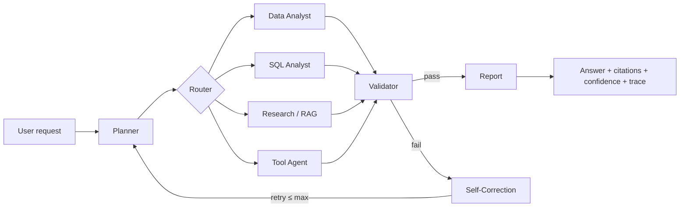

# NEXUS — Autonomous Enterprise Intelligence Fabric

NEXUS is an enterprise AI control plane that ingests documents and tabular data, plans complex tasks, retrieves grounded evidence, runs read-only SQL and sandboxed Python analysis, uses governed tools, validates its own output, **self-corrects failures**, and produces evidence-backed reports — all observable through full traces, audit logs, evaluations, and a professional web dashboard.

It runs locally with **zero paid APIs** (deterministic `local` provider) and deploys with `docker compose up`.



## Why it exists

Dashboards-with-a-chatbot don't survive enterprise scrutiny. NEXUS is built around four non-negotiables:

1. **Grounded** — answers carry real citations bound to ingested chunks.
2. **Auditable** — every plan, agent step, tool call, validation, and correction is traceable by `trace_id`.
3. **Safe** — AST-enforced read-only SQL, a process-isolated Python sandbox, tool permission levels, human approval gates for HIGH/CRITICAL actions.
4. **Measurable** — an evaluation runner with faithfulness, correctness, retrieval relevance, success-rate and latency metrics.

## Architecture

| Layer | Implementation |
|---|---|
| API | FastAPI + Pydantic, OpenAPI at `/docs` |
| Async execution | TaskQueue abstraction: in-process worker (default) or Redis-backed; HTTP never blocks |
| Orchestration | Stateful workflow engine (LangGraph-equivalent): typed `WorkflowState`, nodes, conditional routing, bounded retries |
| Agents | Planner, Research, Retrieval, Data Analyst, SQL Analyst, Tool, Validator, Report |
| LLM abstraction | `LLMProvider`: Groq · OpenAI / Anthropic / Gemini / Ollama / **local heuristic** (no key required) |
| Embeddings | `EmbeddingProvider`: OpenAI / Ollama / **local deterministic hash** |
| Retrieval | Hybrid: vector cosine + BM25 keyword + RRF fusion + lexical rerank + metadata filters |
| Storage | SQLite (default) or PostgreSQL; pgvector-ready vector store |
| Execution | Read-only SQL (sqlglot AST), Python sandbox (subprocess + AST allowlist + timeout + memory) |
| Frontend | React 19 + TypeScript strict + Vite + Tailwind, 10 pages incl. trace viewer |
| Governance | RBAC roles, rate limiting, approval workflow, audit logs, redacted logging |

Full docs: [`docs/`](docs/) — ARCHITECTURE, PRODUCT_REQUIREMENTS, IMPLEMENTATION_PLAN, SECURITY_MODEL, THREAT_MODEL, API_SPEC, DATA_MODEL, AGENT_DESIGN, EVALUATION_PLAN, DEPLOYMENT.

## Features

- **Ingestion**: PDF, DOCX, TXT, MD, CSV, XLSX → extract → chunk (page/section metadata) → embed → vector + keyword index
- **Hybrid RAG** with real citations (chunk IDs, filenames, pages)
- **8 real agents** with explicit roles and typed outputs
- **Self-correction engine**: classifies failures (poor retrieval, invalid SQL, sandbox error, unsupported claims, timeout…) → applies strategy → retries with a hard cap → visible in the trace UI. Demo: the Workspace *"Simulate self-correction"* checkbox injects a real failure so the recovery loop is observable live.
- **Research engine**: controlled retrieval-strategy experiments (vector vs keyword vs hybrid) scored per strategy with per-slice metrics.
- **Read-only SQL**: only SELECT/CTE survive AST validation; row caps, timeouts, audit
- **Python sandbox**: separate process, import allowlist, restricted builtins, timeout, memory cap — no shell, ever
- **Tools**: document search, SQL, sandboxed analysis, file inspection, calculator, allowlisted HTTP — with LOW/MEDIUM/HIGH/CRITICAL permission levels
- **Human approvals** for HIGH/CRITICAL actions (UI approve/reject with audit)
- **Evaluation runner**: JSONL-style datasets → run agents → store faithfulness/correctness/retrieval metrics
- **Observability**: trace IDs, step timeline, tool calls, validation results, correction history, redacted logs
- **Live workspace**: submits async and streams progress by polling the trace — steps, validations, and corrections appear as they execute
- **Dashboard**: Dashboard, AI Workspace, Agents, Knowledge, Data Sources, Task Trace, Evaluations, Approvals, System Health, Settings

## Quick start (local, no Docker)

Requirements: Python 3.12+, Node 20+.

```bash
# 1. Backend
cd backend
python -m venv .venv && source .venv/bin/activate      # Windows: .venv\Scripts\activate
pip install -e ".[dev]"
alembic upgrade head        # optional — app auto-creates schema too
uvicorn nexus.main:app --reload --port 8000

# 2. Seed demo data (separate terminal)
python scripts/seed_demo_data.py

# 3. Frontend
cd frontend
npm install
npm run dev                  # http://localhost:5173 (proxies /api → :8000)
```

Open **http://localhost:5173** → Knowledge → *Load demo data* → AI Workspace → run the flagship question:

> Analyze why profitability declined in Q3. Compare Q2 and Q3, identify the top three contributing factors, verify findings using company documents, and provide three recommended actions.

Then open **Task Trace** to watch planner → analysis → retrieval → validation → corrections → report.

### Sign-in (bootstrap users)

First startup seeds two users (dev passwords; override with `NEXUS_ADMIN_PASSWORD` / `NEXUS_ANALYST_PASSWORD`):

| Email | Password | Role |
|---|---|---|
| `admin@nexus.local` | `nexus-dev-password` | admin |
| `analyst@nexus.local` | `nexus-dev-password` | analyst |

Production (`NEXUS_ENV=production`) skips bootstrap unless passwords are explicitly set.

### Flagship demos (scripted)

With the server running on `:8000`:

```bash
python scripts/run_flagship_demos.py                      # all four
python scripts/run_flagship_demos.py --demo correction    # just the self-correction demo
```

1. **Q3 profitability** — full pipeline with real citations
2. **Self-correction** — injected failure → validator fail → correction → recovery (visible in trace)
3. **Retrieval research** — vector vs keyword vs hybrid experiment with a winner
4. **Customer churn** — churn rate, segment breakdown, churn reasons from `customers.csv`

## Docker (guaranteed path)

```bash
cp .env.example .env        # set NEXUS_SECRET_KEY at minimum
docker compose up --build
# frontend: http://localhost:8080
# API:      http://localhost:8000  (OpenAPI: /docs)
```

Services: `postgres` (pgvector), `redis`, `backend`, `worker`, `frontend` (nginx + proxy). Healthchecks included.

## Configuration

Copy `.env.example` → `.env`. Key variables:

| Variable | Purpose |
|---|---|
| `LLM_PROVIDER` | `local` (default, no key) · `groq` · `openai` · `anthropic` · `gemini` · `ollama` |
| `GROQ_API_KEY` / `GROQ_MODEL` | Groq-hosted models (OpenAI-compatible API, built-in 429/5xx backoff) |
| `OPENAI_API_KEY` / `ANTHROPIC_API_KEY` / `GOOGLE_API_KEY` | provider credentials (never committed) |
| `EMBEDDING_PROVIDER` | `local` · `openai` · `ollama` |
| `DATABASE_URL` | SQLite default; `postgresql+asyncpg://…` in production |
| `REDIS_URL` | optional; in-process queue when empty |
| `VECTOR_STORE` | `memory` · `pgvector` |
| `MAX_AGENT_ITERATIONS` / `MAX_RETRIES` | hard loop caps |
| `SQL_MAX_ROWS` / `SQL_TIMEOUT_SECONDS` | SQL guardrails |
| `SANDBOX_TIMEOUT_SECONDS` / `SANDBOX_MEMORY_MB` | sandbox limits |
| `HTTP_TOOL_ALLOWLIST` | SSRF protection for the HTTP tool |
| `RATE_LIMIT_PER_MINUTE` / `CORS_ORIGINS` / `API_KEYS` | abuse & access controls |

## API

Base `/api/v1`, interactive docs at `/docs`. Highlights:

```
POST /api/v1/tasks            GET  /api/v1/tasks/{id}    GET /api/v1/tasks/{id}/trace
POST /api/v1/query            POST /api/v1/documents     POST /api/v1/datasets
GET  /api/v1/agents           GET  /api/v1/tools
GET  /api/v1/approvals        POST /api/v1/approvals/{id}/approve|reject
POST /api/v1/evaluations/run  GET  /api/v1/evaluations/runs
POST /api/v1/evaluations/research/retrieval-comparison
GET  /api/v1/auth/login       GET  /api/v1/auth/me
GET  /health                  GET  /ready
```

See [docs/API_SPEC.md](docs/API_SPEC.md).

## Testing

```bash
cd backend
pytest -q                 # 75 tests: SQL safety, sandbox escapes, retrieval citations,
                          # tool permissions, approvals, self-correction, retries, API,
                          # evaluation, research experiments, auth/RBAC, bootstrap users
ruff check nexus tests    # lint
```

Tests are deterministic and use the `local` provider — no paid API calls in CI.

Frontend (5 vitest tests + lint + strict build):

```bash
cd frontend
npm test
npm run build   # tsc strict + vite build
npm run lint
```

End-to-end scripted demos against a live server: `python scripts/run_flagship_demos.py`.

## Security notes

- SQL: AST SELECT-only; multi-statement/DDL/DML/PRAGMA/ATTACH rejected (`backend/nexus/execution/sql_engine.py`)
- Python: AST import allowlist + restricted builtins + subprocess isolation + timeout/memory (`backend/nexus/execution/sandbox.py`)
- Secrets only via environment; `.env` git-ignored; logs redact keys/passwords/tokens
- HIGH/CRITICAL tools cannot execute without an approved `approval_requests` row
- Uploads: extension + MIME + size validation; filenames stored under UUID directories
- Prompt injection: retrieved text is delimited and treated as data; suspicious instruction-like content is flagged in retrieval metadata
- Rate limiting per client; CORS allowlist; JWT/API-key auth roles (admin/analyst/viewer)

## Limitations (honest)

- The `local` provider is heuristic: useful for demos/tests, not a frontier reasoning model. Configure a real provider for hard analysis.
- The sandbox is process-level isolation; for stronger guarantees run the backend container with seccomp/restricted user (documented in SECURITY_MODEL).
- In-memory vector store is single-node; pgvector interface is ready for production scale-out.
- OCR for scanned PDFs is not included (clean error is raised instead).
- SSE/WebSocket live streaming not included — the frontend polls task/trace endpoints.

## Repository layout

```
backend/nexus/    api · agents · orchestration · llm · retrieval · ingestion
                  tools · execution · evaluation · research · security · database
                  observability · services · schemas · workers
backend/tests/    75 unit/integration/security tests
frontend/src/     10 dashboard pages + API client
docs/             architecture, security, API, data model, evaluation, deployment
scripts/          demo data generator + seeder + flagship demo runner
docker/           Dockerfiles + nginx config
```

## License

Provided as an evaluation/demo codebase; add your license before distribution.
