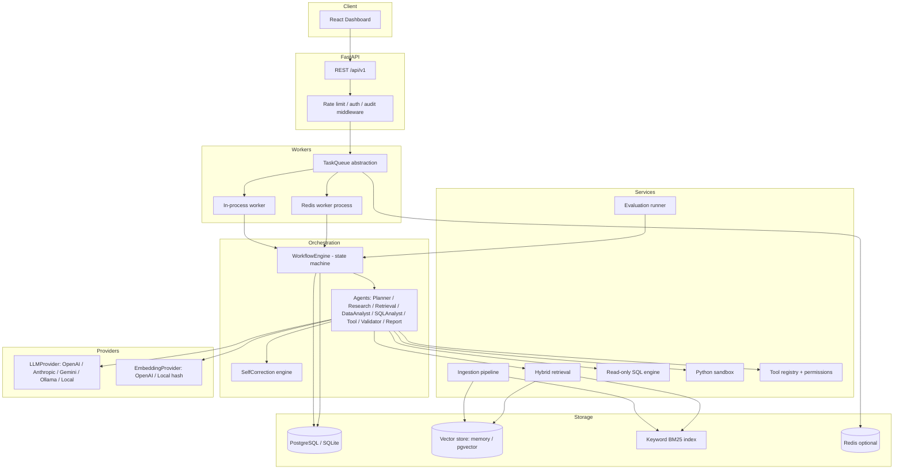

# NEXUS — Architecture

## Overview

NEXUS is an autonomous enterprise intelligence fabric: a control plane that ingests enterprise data, plans complex tasks, retrieves knowledge (RAG), analyzes tabular data, runs read-only SQL, executes sandboxed Python, uses governed tools, validates its own output, self-corrects, and emits full traces/audit logs — all behind a professional web dashboard.

## Key design decisions

| Decision | Rationale |
|---|---|
| **Custom stateful workflow engine** (LangGraph-equivalent: explicit state, nodes, conditional edges, retry limits) | Deterministic, fully testable, no fragile dependency pinning; matches the "stateful graph with conditional routing" requirement exactly. |
| **Provider abstraction** for LLM + embeddings | No provider-specific logic leaks into agents; `local` provider gives a deterministic, useful no-API-key mode. |
| **SQLite default / PostgreSQL (+pgvector) production** | Fresh clone works with zero external services; `DATABASE_URL` swaps storage. |
| **In-process vector store + BM25, pgvector-ready interface** | Hybrid retrieval works offline; production deploys pgvector via the same interface. |
| **In-process asyncio task queue by default, Redis-backed queue optional** | Long-running tasks never block HTTP; Redis optional via env. |
| **Read-only SQL enforced via AST (sqlglot)** | Robust rejection of any non-SELECT statement. |
| **Python sandbox = separate process + AST import allowlist + restricted builtins + timeout + memory** | The LLM never gets a shell; code runs isolated with hard limits. |
| **Everything persisted with trace_id** | Every agent step, tool call, retrieval, validation, and correction is queryable. |

## Request lifecycle

1. Client `POST /api/v1/tasks` → task row created (`queued`), work enqueued.
2. Worker picks task → creates `AgentExecution` + trace.
3. `WorkflowEngine` runs the graph: Planner → Router → (Research | RAG | SQL | DataAnalysis | Tool)* → Validator → (Report | SelfCorrect→retry) with `max_retries` cap.
4. Every node appends to `TaskStep`s and the in-memory `WorkflowState`; results persisted incrementally.
5. Client polls `GET /api/v1/tasks/{id}` and `GET /api/v1/tasks/{id}/trace`.

## Module map (backend/nexus)

| Package | Responsibility |
|---|---|
| `config.py` | Centralized pydantic-settings configuration (dev/test/prod) |
| `database/` | SQLAlchemy models, session, repositories |
| `llm/` | LLMProvider / EmbeddingProvider / RerankerProvider abstractions + implementations |
| `ingestion/` | Extract (PDF/DOCX/TXT/CSV/XLSX) → chunk → embed → index |
| `retrieval/` | Vector store, BM25 keyword index, hybrid fusion, rerank |
| `execution/` | Read-only SQL engine, Python sandbox |
| `tools/` | Tool abstraction, registry, permissions, initial tools |
| `agents/` | Eight real agents with explicit roles and typed outputs |
| `orchestration/` | WorkflowState, graph engine, router |
| `self_correction/` | Failure classification + correction strategies |
| `evaluation/` | Dataset schema, metrics, runner |
| `observability/` | Tracing, redaction, audit log helpers |
| `services/` | Domain services (tasks, documents, datasets, approvals, health) |
| `api/` | FastAPI routers, deps, middleware |
| `workers/` | TaskQueue abstraction, in-process + Redis workers |

## Frontend

React 19 + TypeScript (strict) + Vite + Tailwind. Pages: Dashboard, Workspace, Agents, Knowledge, Data Sources, Task Trace, Evaluations, Approvals, System Health, Settings. Polls REST APIs; trace viewer renders the full agent timeline.
